# Padlás

**English** · [Magyar](README.hu.md)

[](https://github.com/JGeri/Padlas/actions/workflows/release.yml)


[](LICENSE)

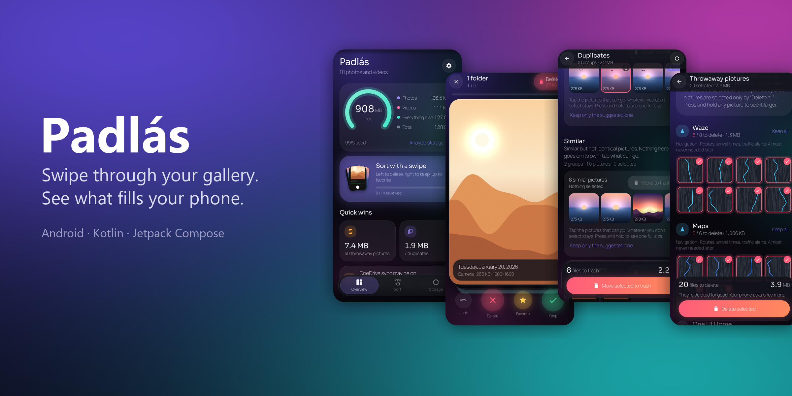

A gallery sorter and storage manager for Android. Swipe through your photos and videos
month by month or folder by folder, and see what is actually filling the phone while you
do it. *Padlás* is Hungarian for attic: the place where things you want to keep, but not
in the living room, go.

Everything happens on the device. Nothing is uploaded unless you set up the optional
Google Drive archive yourself.

<p align="center">
  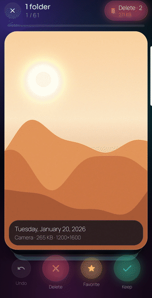
  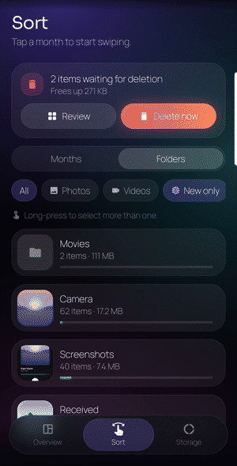
  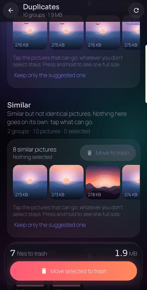
  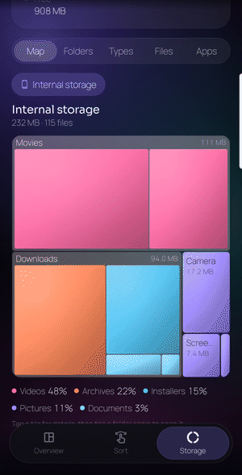
</p>

## What it does

| | |
|---|---|
| **Sort** | Tinder-style deck over any mix of months, folders, photos or videos. Left marks for deletion, right keeps, up favourites. Decisions are saved as you go; the marked pile leaves through one system dialog at the end of the deck or whenever you press *Delete now*. |
| **Storage analyzer** | A WizTree-style map of the whole phone: squarified treemap, folder tree, file types, largest files, app sizes and caches, smart cleanup (old APKs and downloads, empty folders). |
| **Duplicates** | Byte-identical copies are found in three hashing passes and can go in one tap. Bursts and look-alike shots are only *suggested*: nothing leaves those groups until you mark it, because the frame where somebody turned their head is the one worth keeping. |
| **Throwaway pictures** | Screenshots grouped by the app they were taken in (Android writes it into the file name): navigation, home screen, games arrive marked; social and media arrive kept. On-device OCR (ML Kit) finds receipts, tickets and anything that looks like a password or recovery code, which is locked away from deletion. |
| **Large videos** | Media3 Transformer re-encodes big videos with a thermal governor; originals leave only after the compressed copy is verified and published. |
| **Trash, log, rules** | The system trash with restore and empty, a full action log with undo and CSV export, and a rule engine that only runs after a dry run. |

The app is fully localised in English and Hungarian (per-app language in system settings).

| Overview | Sort | Deck |
|---|---|---|
| 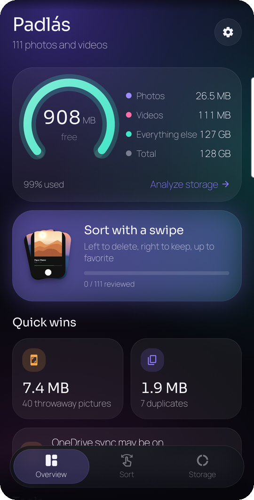 | 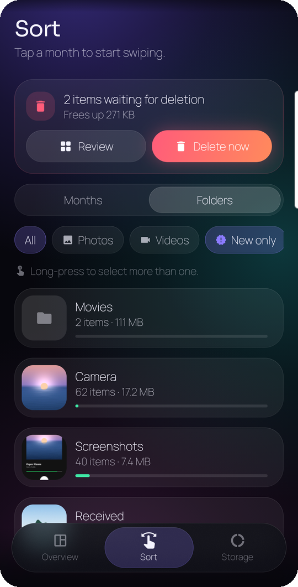 | 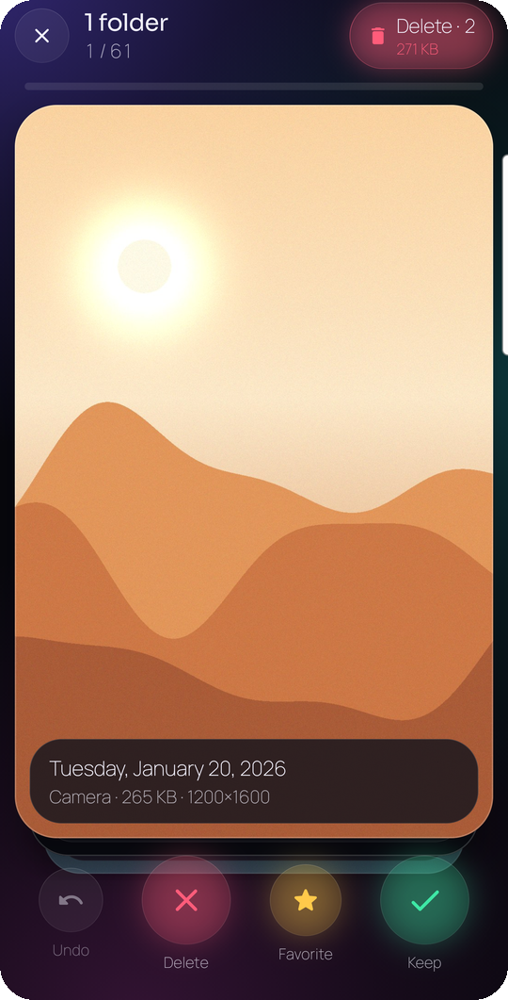 |
| **Duplicates** | **Throwaway pictures** | **Storage map** |
| 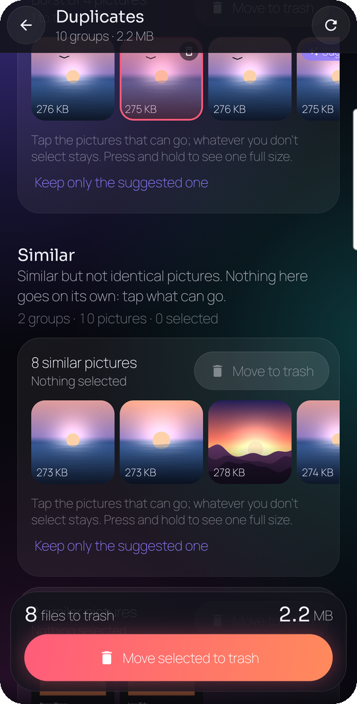 | 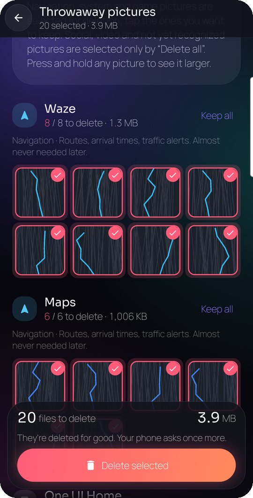 | 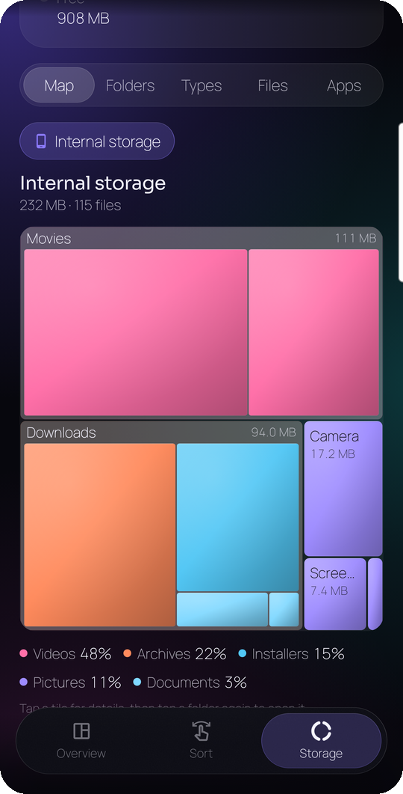 |

*All pictures in these captures are generated mock photos and screenshots; the debug build
can be confined to one folder for exactly this (`adb shell setprop debug.padlas.demo
Pictures/PadlasDemo/`).*

## Design

**Aurora**: a near-black base with slowly drifting violet, cyan and magenta light behind
frosted glass. Motion is spring-based, and screens grow out of what you tapped: a tool tile
expands into its screen, a month's cover flies into the deck's first card and shrinks back
on close (shared-element transitions). The live background can be turned off.

## Engineering notes

A few problems that shaped the code, with the numbers measured on a Galaxy S22 Ultra:

- **Big deletes go in rounds.** A MediaStore trash or delete request carries its URIs
  through the binder twice; thousands of them overflow it. Every request is capped at
  1 000 items and returns null instead of throwing, and the screens continue with the next
  round on their own after the user confirms. 5 000 files are five dialogs, not a crash.
- **A full phone must not crash the app.** The people who need a storage cleaner run at
  0–1 % free space, where SQLite throws `SQLiteFullException`. Every write after a system
  dialog is guarded; the screen says the files went but the bookkeeping did not, and the
  next index pass squares it.
- **Grids without blur.** Blurring a photo grid behind glass bars cost the whole frame
  budget at 1440p; tinted panes instead took the throwaway grid's scroll from 26.6 ms to
  17.5 ms median frame time. The aurora renders on its own layer at ~30 Hz and goes fully
  idle (0 frames) when switched off.
- **Indexing that keeps up.** A MediaStore observer runs a cheap incremental sync while
  the app is open. The sync uses a modification-time watermark *and* an id diff, because a
  photo copied in from a PC keeps its old timestamp. Trashed files keep their rows for the
  bin's 30 days so the log can still undo them.
- **Safety invariants** (from the spec, enforced in code): automation never deletes
  permanently, anything classified as secret is never offered for deletion, every
  permanent delete is one batched system dialog, and the rule engine needs a dry run.

## Architecture

Single-activity Compose app, multi-module, unidirectional data flow (`StateFlow` from
`ViewModel`s), Hilt, Room, WorkManager for every background pass.

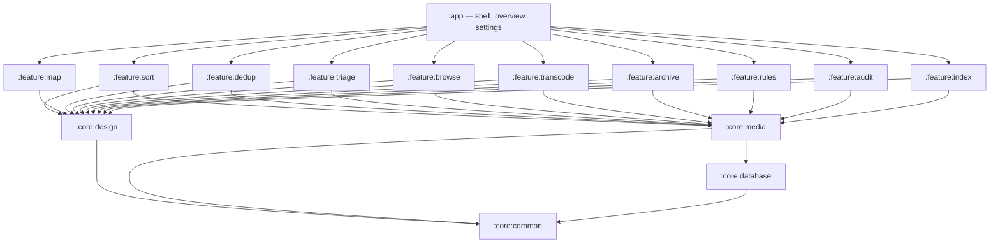

| Module | Responsibility |
|---|---|
| `:core:common` | dispatchers, `Format` (locale-aware numbers and sizes), `UiText`, `Outcome` |
| `:core:design` | Aurora design system: tokens, glass, motion, haptics, shared components |
| `:core:database` | Room entities and DAOs, exported schemas and auto-migrations |
| `:core:media` | MediaStore adapter, hashing, thumbnails, trash/delete/favourite requests |
| `:feature:*` | one feature each, depending only on `core` modules |

Module boundaries and conventions are written down in [`CONTRACT.md`](CONTRACT.md); the
original product spec (Hungarian) is [`padlas-spec.md`](padlas-spec.md).

**Stack:** Kotlin, Jetpack Compose, Material 3, Hilt, Room, WorkManager, Paging 3,
Media3 (ExoPlayer, Transformer), Coil 3, ML Kit (text and barcode), Haze.

## Build

```bash
./gradlew :app:assembleDebug        # installable debug APK (package hu.padlas.debug)
./gradlew :app:assembleProfile      # release code under the debug package, for frame timing
./gradlew testDebugUnitTest         # unit and Robolectric tests
./gradlew :app:assembleRelease      # release APK, signing below
```

Requires JDK 21 (Android Studio's JBR works) and Android SDK platform 36.
`local.properties` holds the SDK path and is not tracked.

**Signing.** The release build reads `keystore.properties` in the repository root
(`storeFile`, `storePassword`, `keyAlias`, `keyPassword`; git-ignored) or the
`PADLAS_KEYSTORE_FILE` / `PADLAS_KEYSTORE_PASSWORD` / `PADLAS_KEY_ALIAS` /
`PADLAS_KEY_PASSWORD` environment variables. Without either, it signs with the debug key.

**CI.** `.github/workflows/release.yml` runs the tests and lint on every push and pull
request, and builds a signed, `apksigner`-verified APK. A `v*` tag publishes it to GitHub
Releases with its SHA-256.

## Install

Grab the APK from [Releases](https://github.com/JGeri/Padlas/releases). It is sideloaded,
so Android treats it as coming from an unknown source; on Samsung phones *Auto Blocker*
has to allow it first.

**Permissions**, and why: photos and videos (the gallery itself) and their location
metadata, *manage media* (optional: trash without a confirmation dialog per batch),
all-files access (optional: the storage analyzer), usage access and the installed-app list
(app sizes, and telling which app a screenshot came from), notifications (progress of
long background passes), network (only for the optional Drive archive).

**Google Drive archive (optional).** Bring your own Google Cloud project: enable the
Drive API, create an Android OAuth client for `hu.padlas` with your signing key's SHA-1
and a Web client whose id goes into the `drive_web_client_id` string resource. The app
uses the `drive.file` scope, so it only ever sees files it created, and deletes a local
original only after Drive reports a byte-identical MD5.

## License

[MIT](LICENSE). Bundled fonts are under the SIL Open Font License; see
[`THIRD_PARTY_LICENSES.md`](THIRD_PARTY_LICENSES.md).
